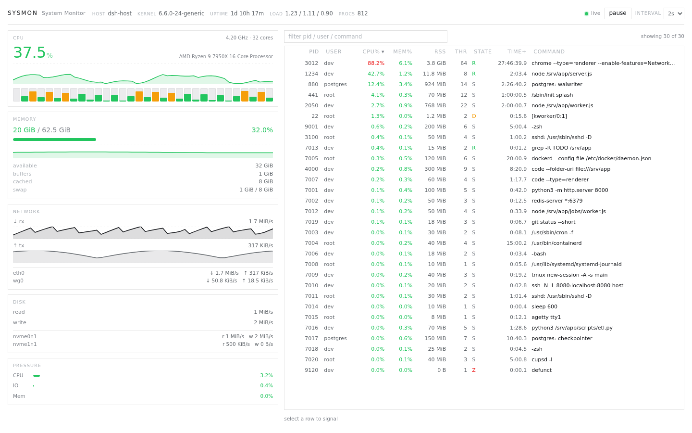
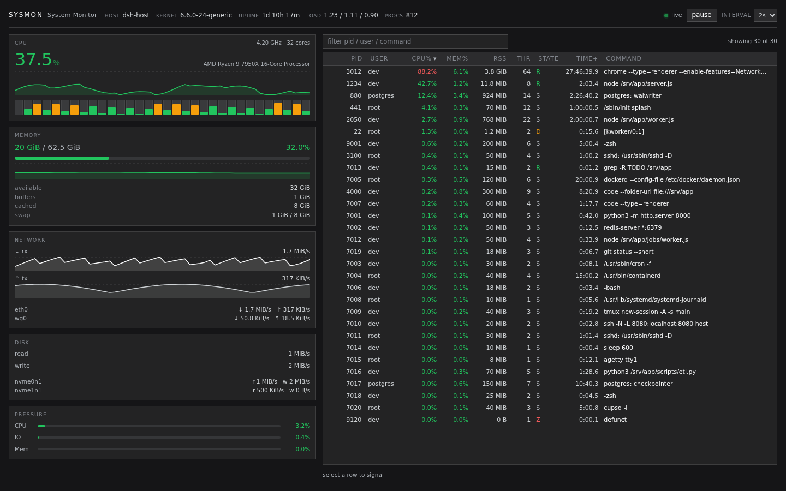

# dsh-sysmon

A btop-style host process and load monitor that lives inside the DSH Web GUI as a
first-class plugin page. One sidebar entry (**System / 系统**) opens a full-width panel
showing CPU, memory, network, disk and pressure, plus a sortable/searchable process table
with two-step SIGTERM/SIGKILL controls.





## Features

- **CPU** — aggregate usage, per-core bars (one per logical core, severity-coloured),
  90-sample history sparkline, current frequency and core model.
- **Memory** — used / total and percentage, available, buffers, cached, swap, history
  sparkline.
- **Network** — rx/tx rates with per-interface breakdown and history sparklines
  (`lo` excluded).
- **Disk** — read/write throughput for physical whole disks (partitions and stacked
  devices are deduplicated).
- **Pressure** — PSI `some avg10` for CPU, IO and memory when the kernel exposes it.
- **Process table** — PID, user, CPU%, MEM%, RSS, threads, state, cumulative CPU time and
  command line; click a header to sort, type to filter by pid/user/command, 400-row render
  cap with a `showing N of M` note.
- **Mobile layout** — below 900 px the panels stack, the process table keeps PID / CPU% /
  MEM% / TIME+ / COMMAND and scrolls on its own, so the panel stays usable on a phone.
- **Signals** — select a row, then press SIGTERM or SIGKILL; the first click arms the
  action, the second click within 3 s sends it. The host refuses `pid 1`, its own pid,
  non-integer pids and signals outside `TERM/KILL/STOP/CONT`.
- **Live/pause/interval** — 1 s, 2 s (default) or 5 s polling; pause stops all traffic;
  polling pauses while the tab is hidden; connection loss keeps the last snapshot and
  shows an `offline — retrying` banner until the host answers again.

## Install

The package is a normal DSH bundle. Install it from GitHub:

```sh
dsh plugin --profile web add github:aliez-ren/dsh-sysmon
```

or, from a local checkout:

```sh
dsh plugin --profile web add /path/to/dsh-sysmon
```

The command records the dependency in the profile, adds the `dsh-sysmon` bundle to
`dsh.profile.bundles`, and the running Web Host picks it up through profile HMR (no
restart needed; an open page refreshes its plugin graph automatically). On a profile
without HMR, restart `dsh web`.

Disable or remove it from **Settings → Plugins → Installed plugins** in the GUI, or:

```sh
dsh plugin --profile web remove dsh-sysmon
```

## How it works

The package carries both halves of a DSH plugin; there is no build step.

| File | Role |
| --- | --- |
| `lib/index.js` | Host half. Samples Linux `/proc` on a 1000 ms timer (cheap probes always; the full `/proc/<pid>` walk only while a snapshot was requested in the last 5 s), keeps a 90-sample history ring, and registers two authenticated exact Fetch routes on the shared `/api` channel. |
| `lib/client.js` | Browser half: a hand-written `window.__ModuleLoader__.load` bundle requiring only the shell-provided `react`. It registers the root `main` panel (`key: sysmon`) and the `sidebar.panellist` navigation row. |
| `cordis.patch.yml` | Bundle patch inserting the `sysmon` host row. |
| `scripts/host-smoke.mjs` | Standalone host verification (19 checks: sampling, CPU math, history cap, kill semantics, route handlers, `apply()` wiring, `/proc` failure paths). |

### API (authenticated)

| Route | Method | Purpose |
| --- | --- | --- |
| `/api/sysmon.snapshot` | `GET` | One snapshot: host facts, load, CPU, memory, network, disk, PSI, counts, processes, history. `cache-control: no-store`. |
| `/api/sysmon.kill` | `POST` | Body `{ "pid": 1234, "signal": "TERM" }`. Answers `{ ok: true }` or `{ ok: false, error }`. |

Both routes go through `ctx.connection.fetch`, so they inherit the Web Host's signed
browser session, Host/Origin checks and owner-principal enforcement: an unauthenticated
request receives `401`, a non-owner peer `403`. Nothing is exposed on a new port and no
additional auth code is invented.

### Cost

- Cheap probes: ~0.5–0.8 ms per second.
- Full process scan: ~8–13 ms per second for ~470 processes, and only while a client is
  viewing the panel (5 s grace after the last snapshot request).
- The sampler timer is `unref()`ed, so it never keeps the Node process alive.
- History is bounded at 90 samples; the process list is bounded by the machine.

## Verification

```sh
cd /path/to/dsh-sysmon
node --check lib/index.js && node --check lib/client.js
node scripts/host-smoke.mjs
```

The browser half was verified through a jsdom interaction suite (polling, sorting,
filtering, selection, two-step kill, error/offline states, cleanup), SSR rendering against
real and hostile snapshots, and live Chromium runs against a real DSH Web Host in light
and dark themes at 1440×900 and 1280×633.

## Limitations

- **Linux only.** All sampling reads `/proc` and `/sys`; on other platforms the panel
  degrades to null fields and an empty process list.
- **Per-process CPU% counts one core**, so a multithreaded process can exceed 100 % (shown
  red above 85 %). Kernel threads appear as `[name]`.
- **PSI memory may be absent** on some kernels (`/proc/pressure/mem`); the Mem meter then
  shows `—`.
- **Signals are real.** There is no undo. The UI requires a deliberate two-step confirm,
  and the host refuses to signal itself or init.
- **400 rows rendered** at most; use the filter to find a specific pid.
- The panel is a global page, not tied to a Session: it shows the machine the DSH host
  runs on, not a container other than the host process's own namespace.
